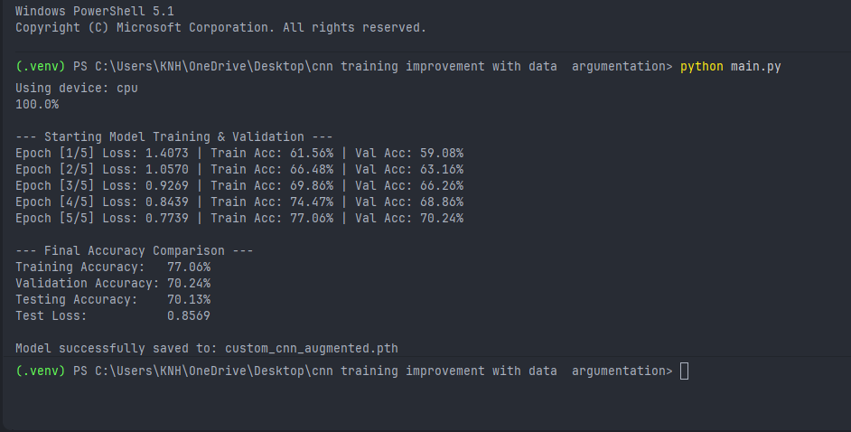

# CNN Training Improvement with Data Augmentation

A Deep Learning image classification project developed using **Python and PyTorch**, focused on improving CNN training through data augmentation, dataset splitting, model evaluation, and performance analysis.

This project implements a custom Convolutional Neural Network (CNN) trained on the CIFAR-10 dataset. It introduces **Random Rotation and Image Normalization** to the training pipeline and establishes separate training, validation, and testing workflows to evaluate model performance and generalization.

The project demonstrates a complete CNN training workflow, from dataset preparation and feature extraction to model optimization, performance evaluation, and checkpoint saving.

---

## 1. Project Overview

Training a deep learning model involves more than defining a neural network and running a training loop. Proper data preparation, augmentation, validation, and testing are essential for understanding how well a model learns and generalizes to unseen data.

This project extends a basic CNN image classifier by introducing a more structured training pipeline.

The primary objectives are:

- Implement a custom CNN architecture using PyTorch.
- Apply random image rotation to augment training samples.
- Normalize image data using CIFAR-10 channel statistics.
- Split the original training dataset into training and validation subsets.
- Monitor training loss and accuracy across multiple epochs.
- Evaluate the model using a separate validation dataset.
- Perform final evaluation using the unseen CIFAR-10 test dataset.
- Save the trained CNN parameters for future inference.

Unlike pretrained classification projects, this model is trained from scratch using a custom CNN architecture.

## 2. Key Features

- **Custom CNN Architecture:** Implements convolutional feature extraction and fully connected classification layers from scratch.
- **Data Augmentation:** Applies random image rotation to training samples.
- **Image Normalization:** Standardizes input channels using CIFAR-10 mean and standard deviation values.
- **Dataset Splitting:** Creates separate training and validation subsets from the original CIFAR-10 training dataset.
- **Reproducible Dataset Split:** Uses a fixed random seed (`42`) when generating training and validation indices.
- **Training Monitoring:** Tracks training loss, training accuracy, and validation accuracy across epochs.
- **Adam Optimization:** Optimizes the network parameters using the Adam optimizer.
- **Cross-Entropy Loss:** Measures multi-class classification error.
- **GPU Detection:** Automatically selects CUDA when available or falls back to CPU.
- **Final Model Evaluation:** Measures performance using the separate CIFAR-10 test dataset.
- **Model Checkpoint:** Saves the trained model parameters as `custom_cnn_augmented.pth`.

## 3. Project Structure

```text
cnn training improvement with data argumentation/
│
├── .venv/
│
├── data/
│   ├── cifar-10-batches-py/
│   │   ├── batches.meta
│   │   ├── data_batch_1
│   │   ├── data_batch_2
│   │   ├── data_batch_3
│   │   ├── data_batch_4
│   │   ├── data_batch_5
│   │   ├── readme.html
│   │   └── test_batch
│   │
│   └── cifar-10-python.tar.gz
│
├── output/
│   └── screenshot.png
│
├── custom_cnn_augmented.pth
│
├── main.py
│
├── requirements.txt
│
└── README.md
```

### Directory and File Description

| File / Directory | Description |
|---|---|
| `.venv/` | Local Python virtual environment containing the project dependencies. |
| `data/` | Stores the downloaded CIFAR-10 dataset. |
| `cifar-10-batches-py/` | Extracted CIFAR-10 dataset containing training batches, testing data, and metadata. |
| `data_batch_1` – `data_batch_5` | Original CIFAR-10 training batches. |
| `test_batch` | Original CIFAR-10 testing batch. |
| `batches.meta` | Contains CIFAR-10 class metadata. |
| `readme.html` | Original CIFAR-10 dataset documentation. |
| `cifar-10-python.tar.gz` | Downloaded CIFAR-10 dataset archive. |
| `output/` | Contains the project execution evidence. |
| `output/screenshot.png` | Screenshot of the actual terminal output showing training progress, validation accuracy, test accuracy, and model-saving confirmation. |
| `custom_cnn_augmented.pth` | Saved parameters of the trained custom CNN model. |
| `main.py` | Main implementation containing the CNN architecture, dataset preparation, training, validation, testing, and model saving. |
| `requirements.txt` | Lists the required Python dependencies. |
| `README.md` | Project documentation. |

## 4. Technologies and Libraries

| Technology | Purpose |
|---|---|
| Python | Core programming language. |
| PyTorch | Neural network development, model training, and evaluation. |
| Torchvision | CIFAR-10 dataset loading and image transformations. |
| CUDA | GPU acceleration when a compatible CUDA environment is available. |

## 5. Dataset — CIFAR-10

This project uses the **CIFAR-10 dataset**, a standard benchmark dataset for image classification.

### Dataset Specifications

| Property | Value |
|---|---|
| Dataset | CIFAR-10 |
| Total Images | 60,000 |
| Original Training Images | 50,000 |
| Validation Images | 5,000 |
| Training Subset | 45,000 |
| Testing Images | 10,000 |
| Image Resolution | 32 × 32 |
| Color Channels | 3 (RGB) |
| Number of Classes | 10 |

### CIFAR-10 Categories

| Class ID | Category |
|---|---|
| 0 | Airplane |
| 1 | Automobile |
| 2 | Bird |
| 3 | Cat |
| 4 | Deer |
| 5 | Dog |
| 6 | Frog |
| 7 | Horse |
| 8 | Ship |
| 9 | Truck |

The original 50,000-image training dataset is divided into:

- **Training Set:** 45,000 images used to optimize the network parameters.
- **Validation Set:** 5,000 images used to monitor model performance during training.

The separate 10,000-image CIFAR-10 test dataset is reserved for final model evaluation.

## 6. Data Augmentation and Image Preprocessing

Data augmentation introduces controlled variations into training images to help the model learn more robust visual representations.

This project uses two preprocessing pipelines: one for training and another for validation and testing.

### 6.1 Random Rotation

```python
transforms.RandomRotation(10)
```

Applies a random rotation of up to approximately 10 degrees to training images.

The transformation introduces variations in image orientation and helps the model learn features that are less dependent on the exact orientation of an object.

The random rotation is applied dynamically when training samples are accessed.

### 6.2 Tensor Conversion

```python
transforms.ToTensor()
```

Converts image data into PyTorch tensors and scales pixel values from the original integer range of 0–255 to floating-point values in the range 0–1.

### 6.3 Image Normalization

```python
mean = (0.4914, 0.4822, 0.4465)
std = (0.2470, 0.2435, 0.2616)

transforms.Normalize(mean, std)
```

Normalizes the RGB image channels using the CIFAR-10 dataset statistics.

Normalization transforms the input values using:

\[
x_{\text{normalized}} = \frac{x - \mu}{\sigma}
\]

Where:

- \(x\) represents the input pixel value.
- \(\mu\) represents the channel mean.
- \(\sigma\) represents the channel standard deviation.

### 6.4 Training Transformation Pipeline

```python
train_transform = transforms.Compose([
    transforms.RandomRotation(10),
    transforms.ToTensor(),
    transforms.Normalize(mean, std),
])
```

The training pipeline applies random rotation, tensor conversion, and normalization.

### 6.5 Evaluation Transformation Pipeline

```python
eval_transform = transforms.Compose([
    transforms.ToTensor(),
    transforms.Normalize(mean, std),
])
```

Validation and testing images use consistent preprocessing without random augmentation.

This ensures that evaluation metrics are calculated using stable, non-augmented input images.

## 7. Dataset Splitting Strategy

The original CIFAR-10 training dataset is divided into training and validation subsets using a fixed random seed.

```python
generator = torch.Generator().manual_seed(42)
indices = torch.randperm(50000, generator=generator)

train_indices = indices[:45000].tolist()
val_indices = indices[45000:].tolist()
```

### Dataset Distribution

| Dataset | Samples | Purpose |
|---|---:|---|
| Training | 45,000 | Model parameter optimization. |
| Validation | 5,000 | Performance monitoring during training. |
| Testing | 10,000 | Final evaluation on unseen images. |

The fixed seed ensures that the same training and validation indices are generated when the splitting code is run under the same conditions.

### Separate Training and Evaluation Transforms

The code creates two versions of the original training dataset:

- `train_data`: Uses random rotation and normalization.
- `eval_data`: Uses tensor conversion and normalization without augmentation.

The `Subset` class then selects the corresponding sample indices for training accuracy and validation evaluation.

This means training accuracy is calculated on the original, non-augmented versions of the 45,000 training samples, while training loss is calculated using the augmented training samples.

## 8. Custom CNN Architecture

The project implements a custom Convolutional Neural Network using PyTorch's `torch.nn` module.

The architecture contains two convolutional feature extraction blocks followed by a fully connected classification network.

### Architecture Overview

```text
Input Image
(3 × 32 × 32)
       |
       v
Convolution Layer 1
3 → 32 Channels
3 × 3 Kernel
       |
       v
ReLU Activation
       |
       v
Max Pooling
2 × 2
       |
       v
Convolution Layer 2
32 → 64 Channels
3 × 3 Kernel
       |
       v
ReLU Activation
       |
       v
Max Pooling
2 × 2
       |
       v
Flatten
       |
       v
Fully Connected Layer
4096 → 128
       |
       v
ReLU Activation
       |
       v
Output Layer
128 → 10
       |
       v
10 Class Prediction Logits
```

### Layer Configuration

| Layer | Configuration | Output Shape |
|---|---|---|
| Input | RGB image | `3 × 32 × 32` |
| Conv2D | 3 → 32, kernel 3 × 3, padding 1 | `32 × 32 × 32` |
| ReLU | Activation | `32 × 32 × 32` |
| MaxPool2D | Kernel 2 × 2, stride 2 | `32 × 16 × 16` |
| Conv2D | 32 → 64, kernel 3 × 3, padding 1 | `64 × 16 × 16` |
| ReLU | Activation | `64 × 16 × 16` |
| MaxPool2D | Kernel 2 × 2, stride 2 | `64 × 8 × 8` |
| Flatten | Feature vector | `4096` |
| Linear | 4096 → 128 | `128` |
| ReLU | Activation | `128` |
| Linear | 128 → 10 | `10` |

The final layer produces 10 raw classification scores, known as logits.

These logits are passed directly to `CrossEntropyLoss`, which internally handles the required log-softmax operation.

## 9. Model Training Configuration

The following hyperparameters are used in the training pipeline.

| Parameter | Configuration |
|---|---|
| Model | CustomCNN |
| Dataset | CIFAR-10 |
| Batch Size | 64 |
| Epochs | 5 |
| Optimizer | Adam |
| Learning Rate | 0.001 |
| Loss Function | CrossEntropyLoss |
| Activation Function | ReLU |
| Pooling | MaxPool2D |
| Data Augmentation | RandomRotation(10) |
| Normalization | CIFAR-10 Mean and Standard Deviation |
| Training Samples | 45,000 |
| Validation Samples | 5,000 |
| Test Samples | 10,000 |
| Computing Device | CUDA if available, otherwise CPU |

## 10. Training Pipeline

The training workflow is divided into separate functions to improve code organization and maintainability.

### 10.1 Custom CNN Definition

```python
class CustomCNN(nn.Module):
```

Defines the network architecture using two primary components:

- `features`: Extracts image features through convolution, activation, and pooling layers.
- `classifier`: Converts extracted features into 10 classification logits.

### 10.2 Training Function

```python
def train_one_epoch(model, loader, criterion, optimizer, device):
```

Responsible for training the model for one complete epoch.

It performs:

1. Switches the model into training mode.
2. Transfers image batches and labels to the selected device.
3. Performs forward propagation.
4. Calculates Cross-Entropy loss.
5. Clears previously accumulated gradients.
6. Calculates gradients through backpropagation.
7. Updates model parameters using Adam.
8. Returns the average batch training loss.

### 10.3 Evaluation Function

```python
def evaluate(model, loader, criterion, device):
```

Evaluates the model using a specified DataLoader.

The function:

- Switches the model into evaluation mode.
- Disables gradient tracking through `torch.inference_mode()`.
- Calculates average loss.
- Generates class predictions.
- Compares predictions against ground-truth labels.
- Calculates classification accuracy.

The function returns:

```python
return average_loss, accuracy
```

### 10.4 Training Accuracy

Training accuracy is calculated using the unaugmented version of the 45,000 training images.

This provides a consistent measure of how well the model classifies its training samples without introducing random rotation during evaluation.

### 10.5 Validation Accuracy

Validation accuracy is calculated using the separate 5,000-image validation subset.

It helps monitor the model's performance on samples that are not used for gradient-based parameter updates.

### 10.6 Final Test Evaluation

After all five training epochs are completed, the model is evaluated using the separate CIFAR-10 test dataset.

The test dataset is not used for training or validation.

This provides an independent evaluation of the final trained model.

## 11. Training Results

The model was trained for five epochs using CPU execution.

<badge color="success">Actual test accuracy: 70.13%</badge>

### Epoch-by-Epoch Performance

| Epoch | Training Loss | Training Accuracy | Validation Accuracy |
|---|---:|---:|---:|
| 1 | 1.4073 | 61.56% | 59.08% |
| 2 | 1.0570 | 66.48% | 63.16% |
| 3 | 0.9269 | 69.86% | 66.26% |
| 4 | 0.8439 | 74.47% | 68.86% |
| 5 | 0.7739 | 77.06% | 70.24% |

### Final Model Evaluation

| Evaluation Metric | Result |
|---|---:|
| Training Accuracy | 77.06% |
| Validation Accuracy | 70.24% |
| Testing Accuracy | 70.13% |
| Test Loss | 0.8569 |

### Performance Analysis

The training results show the following observations:

- Training loss decreased from `1.4073` to `0.7739`.
- Training accuracy increased from `61.56%` to `77.06%`.
- Validation accuracy increased from `59.08%` to `70.24%`.
- Final test accuracy reached `70.13%`.

The final training accuracy is higher than validation accuracy, indicating a performance gap between the training and validation samples.

The validation and test accuracies are close, with a difference of only `0.11` percentage points. This indicates similar measured performance on these two evaluation datasets for this training run.

These results provide a baseline for further experiments involving longer training, additional augmentation strategies, and model architecture improvements.

## 12. Training Output Screenshot

The following screenshot shows the actual terminal output recorded during the model training and evaluation process.



### Actual Terminal Output

```text
Using device: cpu
100.0%

--- Starting Model Training & Validation ---
Epoch [1/5] Loss: 1.4073 | Train Acc: 61.56% | Val Acc: 59.08%
Epoch [2/5] Loss: 1.0570 | Train Acc: 66.48% | Val Acc: 63.16%
Epoch [3/5] Loss: 0.9269 | Train Acc: 69.86% | Val Acc: 66.26%
Epoch [4/5] Loss: 0.8439 | Train Acc: 74.47% | Val Acc: 68.86%
Epoch [5/5] Loss: 0.7739 | Train Acc: 77.06% | Val Acc: 70.24%

--- Final Accuracy Comparison ---
Training Accuracy:   77.06%
Validation Accuracy: 70.24%
Testing Accuracy:    70.13%
Test Loss:           0.8569

Model successfully saved to: custom_cnn_augmented.pth
```

The `100.0%` line represents the dataset download progress displayed during execution.

## 13. Model Saving

After the final test evaluation, the trained CNN parameters are saved using:

```python
model_filename = "custom_cnn_augmented.pth"

torch.save(
    model.state_dict(),
    model_filename
)
```

The saved file contains the model's learned parameters rather than the complete model architecture.

To reuse the checkpoint, the same `CustomCNN` architecture must first be defined and initialized before loading its state dictionary.

Example:

```python
device = torch.device(
    "cuda" if torch.cuda.is_available() else "cpu"
)

model = CustomCNN().to(device)

state_dict = torch.load(
    "custom_cnn_augmented.pth",
    map_location=device,
    weights_only=True
)

model.load_state_dict(state_dict)
model.eval()
```

The checkpoint can then be used for inference with the same input preprocessing and normalization configuration.

## 14. Installation and Setup

### Prerequisites

- Python 3.10 or a compatible version supported by the installed PyTorch release.
- Basic Python programming knowledge.
- PyTorch and Torchvision.
- Sufficient system memory and processing resources.
- An internet connection for the initial dataset download, if the dataset is not already available.

### Step 1 — Clone the Repository

```bash
git clone https://github.com/YOUR_USERNAME/cnn-training-improvement-with-data-augmentation.git
```

Navigate to the project directory:

```bash
cd cnn-training-improvement-with-data-augmentation
```

Replace `YOUR_USERNAME` with your GitHub username.

### Step 2 — Create a Virtual Environment

```bash
python -m venv .venv
```

Activate the environment.

**Windows PowerShell:**

```powershell
.venv\Scripts\Activate.ps1
```

**Windows Command Prompt:**

```cmd
.venv\Scripts\activate
```

**Linux / macOS:**

```bash
source .venv/bin/activate
```

### Step 3 — Install Dependencies

Upgrade pip:

```bash
python -m pip install --upgrade pip
```

Install the dependencies:

```bash
pip install -r requirements.txt
```

### Step 4 — Run the Application

```bash
python main.py
```

The application automatically:

1. Detects the available computing device.
2. Downloads the CIFAR-10 dataset if required.
3. Applies the configured image transformations.
4. Creates training and validation subsets.
5. Initializes the custom CNN.
6. Trains the model for five epochs.
7. Calculates training and validation metrics.
8. Evaluates the model on the test dataset.
9. Saves the trained parameters to `custom_cnn_augmented.pth`.

## 15. Requirements

The `requirements.txt` file should contain:

```text
torch
torchvision
```

For GPU training, install a compatible CUDA-enabled PyTorch build according to the available hardware and official PyTorch installation instructions.

## 16. Current Limitations

Although the project introduces a more structured training pipeline, several improvements remain possible:

- Training is limited to five epochs.
- The CNN architecture contains only two convolutional blocks.
- Data augmentation currently uses random rotation only.
- No dropout or batch normalization layers are included.
- No learning-rate scheduler is implemented.
- No early stopping mechanism is implemented.
- No confusion matrix or per-class accuracy analysis is included.
- The model checkpoint saves the final epoch rather than selecting the best validation checkpoint.
- No direct before-and-after baseline experiment is included to quantify the isolated effect of data augmentation.

## 17. Future Improvements

Potential extensions include:

- Random horizontal flipping and additional augmentation techniques.
- Training and validation loss visualization.
- Accuracy comparison across epochs.
- Overfitting and generalization analysis.
- Dropout and Batch Normalization.
- Learning-rate scheduling.
- Early stopping.
- Confusion matrix visualization.
- Per-class precision, recall, and F1-score.
- Best-model checkpoint selection based on validation performance.
- Deeper CNN architectures.
- Custom image inference using the trained checkpoint.
- Experimenting with different optimizers and learning rates.

## 18. Learning Outcomes

This project provides practical experience in:

- Custom CNN architecture development.
- Convolutional feature extraction.
- Data augmentation using Torchvision.
- Image normalization and preprocessing.
- Training, validation, and testing dataset separation.
- Reproducible dataset splitting.
- PyTorch Dataset, Subset, and DataLoader.
- Forward propagation and backpropagation.
- Cross-Entropy loss calculation.
- Adam optimization.
- Multi-epoch model training.
- Training and validation performance monitoring.
- Final model evaluation.
- Model checkpoint saving and loading.
- Understanding model generalization.

## 19. Author

**Moe Htet Ar Kar (Phoe Cho)**

Machine Learning & Computer Vision Developer

**Technical Focus:**
- PyTorch Deep Learning
- Convolutional Neural Networks
- Computer Vision
- Image Classification
- Data Augmentation
- Model Training and Evaluation

---

*Developed as part of a practical learning journey in PyTorch Deep Learning and Computer Vision.*